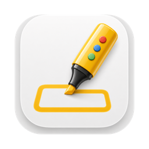
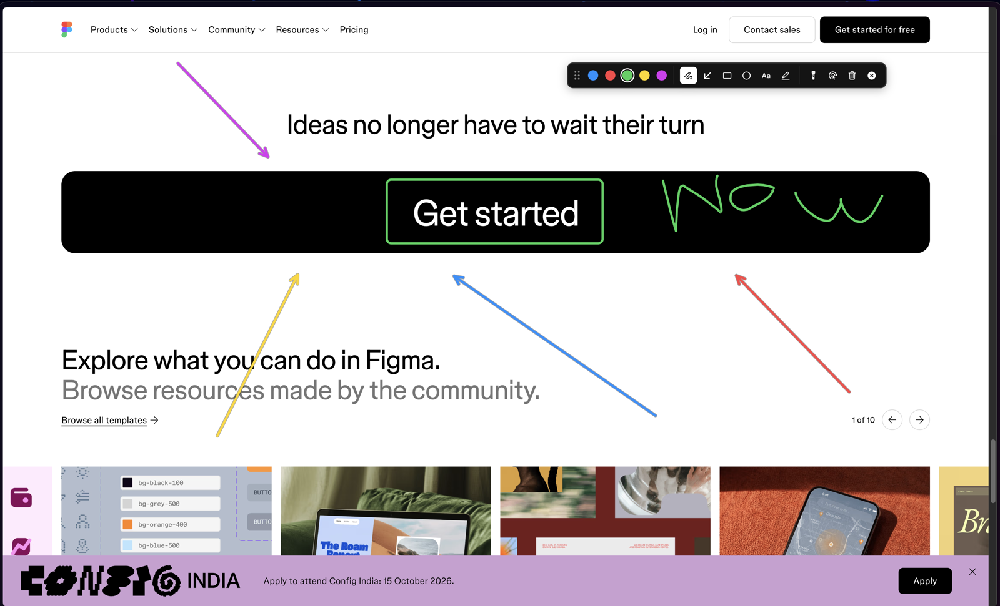
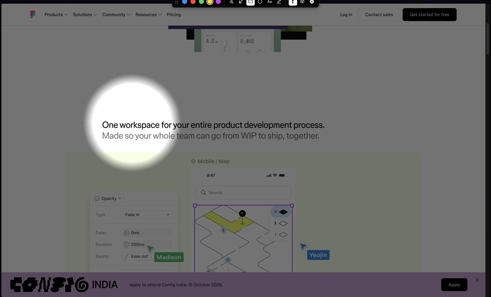

<p align="center">
  
</p>

<h1 align="center">ScreenBox</h1>

<p align="center"><b>Draw on your screen while you record.</b></p>

A tiny macOS menu bar app for drawing highlight boxes on screen while recording or presenting.

Press a hotkey, drag a box around whatever you're talking about, and it fades away on its own. No editing pass, no timeline annotations.

<p align="center">
  
  
</p>

- **Seven drawing tools** — freehand, arrow, rectangle, ellipse, text, a
  translucent highlighter, and a redaction block, each one key away.
- **Marks fade on their own** — draw, keep talking, and the ink clears itself;
  no undo pass to clean up before the next take.
- **Spotlight mode** dims the screen to a soft-edged circle that follows the
  pointer, for pulling attention to one part of a demo without a drawing tool.
- **Click-through** hands clicks and scrolling straight to the app underneath,
  so you can keep scrolling the page you're demoing without leaving draw mode.
- **Global hotkey, no Accessibility permission** — a menu bar icon and
  **⌃⌥⌘B**, nothing else running in the background.

## Install

Requires macOS 13 or later. The build is universal, so it runs natively on both
Apple silicon and Intel.

### Homebrew (recommended)

```bash
brew install --cask Orva-Studio/tap/screenbox
```


### Manually

**1. Install it.** Grab **ScreenBox-x.y.z.dmg** from the
[latest release](https://github.com/Orva-Studio/screenbox/releases/latest), open
it, and drag ScreenBox to Applications. (The `.zip` next to it is the same app,
for scripted installs.)

ScreenBox is signed with Orva Studio's Developer ID and notarized by Apple: macOS
asks once whether to open an app from the internet, and there's no security
setting to override or quarantine flag to clear.

**2. Launch it.** Double-click ScreenBox in Applications. Nothing appears in the
Dock and no window opens — ScreenBox runs as a menu bar app, so the only sign
it's running is the box icon up in the menu bar. (It won't show up in ⌘-Tab
either.) Then press **⌃⌥⌘B** to draw.

There's no installer, no background daemon, and no Accessibility permission to
grant — the app is a menu bar icon and a global hotkey, nothing else. To have it
start with your Mac, add it to **System Settings → General → Login Items**.

To uninstall, quit it from the menu bar and drag `/Applications/ScreenBox.app`
to the trash; `defaults delete local.screenbox` clears its saved preferences.

## Build

```bash
./build.sh
open build/ScreenBox.app
```

Requires the Swift toolchain (Xcode or Command Line Tools). No dependencies.

To keep a build you made yourself, drag `build/ScreenBox.app` to `/Applications`.
Local builds are signed ad hoc; set `SIGN_IDENTITY` to a Developer ID to sign
one as a release is.

## Use

**⌃⌥⌘B** toggles draw mode on whichever screen the mouse is on. **⌃⌥⌘F**
toggles fade-out from anywhere, without entering draw mode first.

While drawing:

| Key | Action |
| --- | --- |
| drag | draw with the current tool |
| `P` `A` `R` `O` `T` `H` | freehand / arrow / rectangle / ellipse / text / highlighter |
| `D` | redact — drag an opaque block over something the audience shouldn't see |
| `1`–`5` | blue / red / green / yellow / purple |
| `S` | toggle the spotlight |
| `B` | show/hide the toolbar |
| `X` | click through — let clicks and scrolling reach the app underneath |
| `[` `]` | thinner / thicker stroke (highlighter size while it's selected, spotlight size while it's up) |
| `−` `=` | less / more corner radius |
| `F` | toggle fade-out on/off (**⌃⌥⌘F** from anywhere) |
| `⌘Z` | undo last mark |
| `C` | clear all, stay in draw mode |
| `esc` | clear and exit draw mode |

The **highlighter** drags a wide translucent band in the current colour, so
whatever it covers still reads through — yellow over a line of code or a
paragraph works the way you'd expect. Its size is independent of the pen's
stroke thickness — resize it with `[` and `]` while it's selected, or pick a
size from **Highlighter Size** in the menu.

**Redact** (`D`) drags an opaque black block over whatever it covers — an API
key in a terminal, an email address in a settings pane, a customer name in a
dashboard. Unlike every other mark it never fades, however fade is configured:
it stays until you clear it with `C`, or leave draw mode with `esc`. It's a
cover, not a filter, so it hides the region completely rather than blurring it.

Two things to know. The block is anchored to the screen, not to the content
underneath — scroll the window and the secret moves out from behind it. And it
only helps when your audience is seeing the *display*: if you're sharing a
single window rather than a whole screen, the overlay isn't in that capture at
all, so the block is invisible to them while looking correct to you.

The **spotlight** dims the whole screen except a soft-edged circle that follows
the pointer, for pulling attention to one part of a demo. It's a mode, not a
tool: every drawing tool still works while it's on. `[` and `]` resize it, or
pick a size from **Spotlight Size** in the menu.

`B` hides the floating **toolbar** for a clean recording and brings it back —
every tool, colour and mode on it has a key equivalent, so nothing is lost while
it's away. The state is saved like the other preferences, and **Show Toolbar**
in the menu finds it again if you forget the key.

**Click through** (`X`, the toolbar button, or **⌃⌥⌘X** from anywhere) hands
clicks and scrolling back to whatever is underneath, so you can scroll the page
you're demoing without leaving draw mode. Existing marks stay on screen; you
just can't draw new ones until it's off. The menu bar icon changes while it's
active, since clicks going straight through is otherwise indistinguishable from
having exited — and the toolbar itself dims to a translucent outline, since
that's the thing you're actually looking at.

Because every click passes through, the way back can't be a click on the
overlay — use the global **⌃⌥⌘X**, the `X` key (while ScreenBox still has
focus), or the toolbar button, which is a separate window and keeps taking
clicks — or **Click Through** in the menu bar, which is where the changed icon
is pointing anyway. Hiding the toolbar with `B` costs you the button; the other
three still work. Leaving draw mode clears it too.

By default the pointer is **left alone** in draw mode — no crosshair, no I-beam —
so a recording doesn't give away that an annotation tool is running. Turn off
**Keep Normal Cursor** in the menu if you'd rather have the crosshair back.

> `⌘Z` only applies to marks still on screen. With fade on (the default) a mark
> is gone about a third of a second after you release the mouse, so there is
> usually nothing left to undo. Press `F` (or **⌃⌥⌘F**) to turn fade off first.

**Keyboard Shortcuts** in the menu opens the same table as a window, so the
reference is one click away without leaving the app. **About ScreenBox** shows
the version and links back here.

## Preferences

Colour, thickness, corner radius, fade speed, and fade on/off all live in the
menu bar and are **saved automatically** — change them however you like and
they'll be the same next launch. Keyboard changes made mid-draw persist too.

Defaults: yellow, 4pt, square corners, fast fade.

Preferences are stored in `UserDefaults` under `local.screenbox`. To reset
everything:

```bash
defaults delete local.screenbox
```

### Adding a preference

`Sources/Prefs.swift` is the single source of truth. Add a `Key` case, a
computed property, and a default in `register(defaults:)`. Because every write
fires `onChange`, the menu re-ticks and the live overlay redraws with no extra
wiring.

## Releases

The version is derived from git tags — nothing to bump by hand. `build.sh`
stamps `CFBundleShortVersionString` from the latest tag (`v1.2.0` → `1.2.0`, or
`1.2.0-dev` for commits after it) and `CFBundleVersion` from the commit count.
The running version shows in **About ScreenBox**, in the menu.

To cut a release:

```bash
./scripts/release.sh 1.2.0
```

It refuses unless you're on a clean `main`, fast-forwards, checks the tag is
free, does a smoke build so a broken commit can't burn a tag, then tags and
pushes.

The push triggers `.github/workflows/release.yml`, which builds a universal
binary on `macos-latest`, packages it as both a drag-to-install `.dmg` and a
`.zip`, and publishes a GitHub release with both attached.

To build a disk image by hand:

```bash
./build.sh
./scripts/make-dmg.sh          # -> build/ScreenBox-<version>.dmg
```

Releases are signed with Orva Studio's Developer ID (hardened runtime, secure
timestamp) and notarized: the workflow imports the certificate from the
`DEVELOPER_ID_P12` and `DEVELOPER_ID_PASSWORD` secrets, `build.sh` signs with it,
and `scripts/notarize.sh` sends the app, then the DMG, to Apple with the App Store
Connect API key (`APPLE_API_KEY`, `APPLE_API_KEY_ID`, `APPLE_API_ISSUER`) and
staples the tickets. Without those secrets a build is signed ad hoc, as local
builds are.

## Notes

- The overlay window only exists while draw mode is active, so it never
  intercepts clicks when you're working normally.
- While draw mode *is* active the overlay swallows clicks on that screen — press
  `X` to click through, or `esc` to leave.
- Boxes are stroked with a dark halo so they stay readable on light and dark
  backgrounds.
- Uses a Carbon hotkey, so no Accessibility permission is required.
- Draws over normal windows but not over fullscreen apps.

## Licence

MIT — see [LICENSE](LICENSE).

## Fade speed presets

| Preset | Hold | Fade |
| --- | --- | --- |
| Instant | 0s | 0.15s |
| Fast (default) | 0.15s | 0.2s |
| Medium | 0.35s | 0.4s |
| Slow | 1.0s | 0.8s |

Edit `Prefs.speedChoices` in `Sources/Prefs.swift` to change or add presets.
